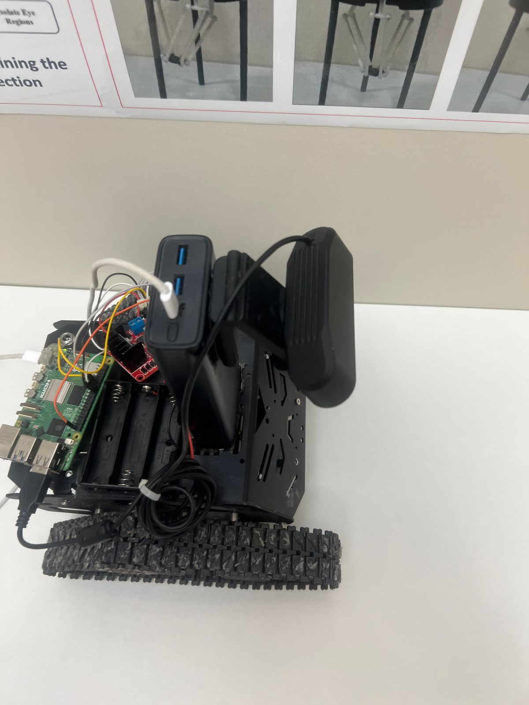
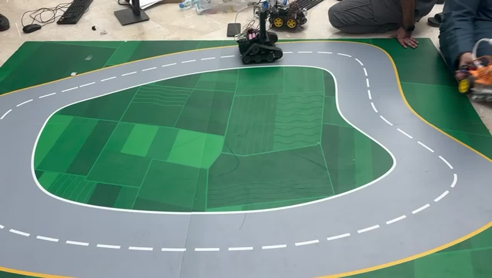
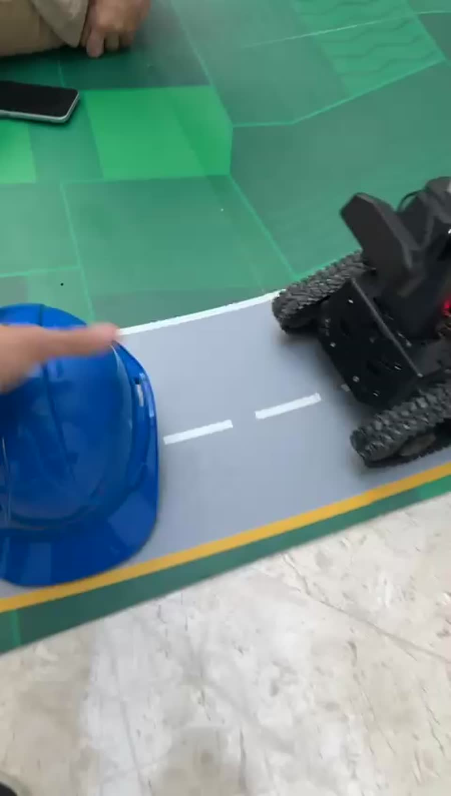
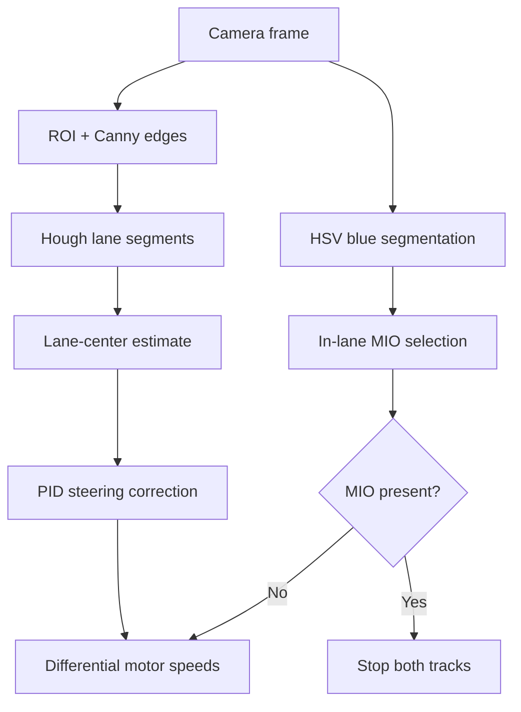

# Autonomous Lane-Assist Robot

A Raspberry Pi 5 autonomous tracked robot that combines **computer vision**, **PID control**, and **differential steering** to follow lane markings and stop for the closest blue obstacle inside its ego lane.



## Highlights

- Real-time lane detection with grayscale conversion, Canny edges, a region of interest, and the probabilistic Hough transform
- PID-based lane-centering control translated into independent left/right track speeds
- HSV color segmentation for blue-obstacle detection
- Most Important Object (MIO) selection that ignores objects outside the ego lane
- Automatic stop while an in-lane obstacle is present and automatic resume after it clears
- Raspberry Pi GPIO motor control plus a `--no-motors` preview mode for laptop testing
- Unit tests and a GitHub Actions workflow

## Demonstrations

| Lane following | In-lane obstacle stop |
|---|---|
| [](media/lane-following-demo.mp4) | [](media/obstacle-stop-demo.mp4) |
| [Watch the lane-following video](media/lane-following-demo.mp4) | [Watch the obstacle-stop video](media/obstacle-stop-demo.mp4) |

## Perception and control pipeline



## Hardware

- Raspberry Pi 5
- Devastator-style tracked robot platform with two DC motors
- L298N dual H-bridge motor driver
- USB camera (the prototype used a Logitech webcam)
- Battery supply for the robot and electronics

### GPIO mapping

| Drive side | Forward GPIO | Backward GPIO |
|---|---:|---:|
| Left track | 17 | 27 |
| Right track | 23 | 24 |

Confirm the L298N input wiring and raise the tracks before the first powered test. If the robot moves backward, swap that motor's leads or its forward/backward GPIO assignments.

## Software setup

The code targets Python 3.10+ and uses OpenCV, NumPy, and GPIO Zero.

```bash
git clone https://github.com/KhaledChaim/autonomous-lane-assist-robot.git
cd autonomous-lane-assist-robot

python3 -m venv .venv
source .venv/bin/activate
python -m pip install --upgrade pip
pip install -r requirements.txt
```

On Raspberry Pi OS, enable the camera and GPIO interfaces as required by your setup. If an OpenCV wheel is unavailable for your Raspberry Pi image, install OpenCV from the OS package manager instead.

## Run

Test the camera and vision pipeline without moving the robot:

```bash
python src/lane_assist_robot.py --no-motors
```

Run on the Raspberry Pi with motor control enabled:

```bash
python src/lane_assist_robot.py
```

Useful options:

```text
--camera N    OpenCV camera index (default: 0)
--no-motors   Disable GPIO and run perception only
--headless    Disable the OpenCV display window
```

Press `q` in the display window or Ctrl+C in the terminal to stop. The program stops both motors and releases the camera during shutdown.

## Calibration

The default values match the university prototype and its 480 x 320 camera feed. For a different track or camera, calibrate:

- ROI vertices and Hough-transform thresholds in `detect_lane_lines`
- PID gains and `base_speed` in `RobotConfig`
- HSV bounds and `obstacle_min_area_px`
- Ego-lane bounds (`lane_left_fraction` and `lane_right_fraction`)
- `single_lane_offset_px` for frames where only one boundary is visible

Always tune with the robot raised first, then test at low speed on a clear track.

## Repository structure

```text
.
├── src/lane_assist_robot.py       # Vision, MIO, PID, and motor-control loop
├── tests/test_lane_assist_robot.py
├── media/                         # Real build photo and demonstration videos
├── docs/project-summary.md        # Project background, team, and results
├── requirements.txt
└── .github/workflows/tests.yml
```

## Results

The final prototype followed the marked course for repeated laps, stopped when a blue obstacle entered its ego lane, ignored out-of-lane obstacles, and resumed after the path was cleared. See [the project summary](docs/project-summary.md) for the verified implementation scope.

## Limitations and next steps

- Blue HSV thresholds are track-specific and sensitive to lighting.
- Bounding-box position is used as a proximity cue; there is no direct depth measurement.
- Lane-center estimation uses line endpoints rather than a full temporal lane model.
- The current gains are tuned for one robot, camera position, and course.

Good next steps include camera calibration, temporal lane fitting, distance sensing, adaptive PID tuning, Kalman tracking, and a learned object detector for less controlled environments.

## Academic context

Developed as a team project for **AIRE475 – Autonomous Cars and Drones** at Abu Dhabi University. This repository presents the implemented prototype and credits the full project team in [docs/project-summary.md](docs/project-summary.md).
